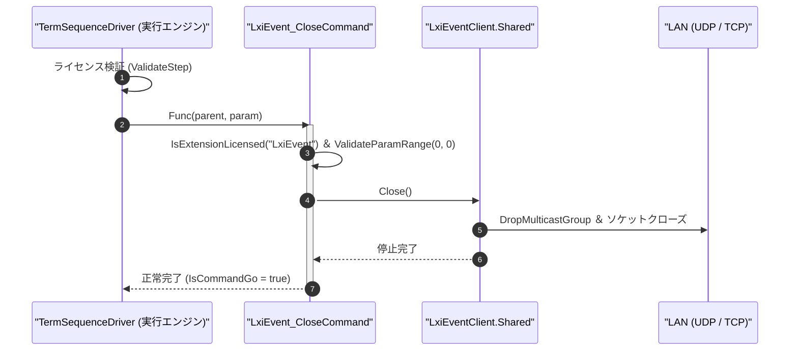

# コマンドリファレンス：LxiEvent_Close

👉 [← LxiEvent アドイン取扱説明書に戻る](./LxiEvent取扱説明書.Md)

## 概要

**LxiEvent_Close** は、稼働中の LXI Event リスナーを停止し、UDP マルチキャストグループからの離脱およびソケットリソース解放を行う通信制御系コマンドです。`LxiEventClient.Shared.Close()` を呼び出します。

---

## 💡 書式・パラメータ仕様

### コマンド構文

```csv
,SEQUENCE, [ステップキー], LxiEvent_Close
```

### パラメータ（引数）一覧

| 引数位置 | 引数名 | 必須/任意 | 説明・制約 |
| :--- | :--- | :---: | :--- |
| － | （なし） | － | 引数を指定すると `ValidateParamRange(0, 0)` 違反として拒否されます。 |

---

## 🔄 特殊置換規約・分岐規約の適用

* **動的置換（`$`）**: 非適用。
* **ジャンプ先指定（`#`）**: 非適用。
* **共通コマンド指定（`@`）**: 非適用。
* **エイリアス（別名）**: `Analysis_LxiEvent_Close`, `Sqn_LxiEvent_Close`

---

## 💡 動作例（正しい構文での記述例）

### スクリプト記述例

※COMMAND ブロック配下の子要素行（PARAM, SEQUENCE）は必ず行頭カンマから開始し、スペースインデントや行末コメント（`;`）は記述しないでください。

```csv
COMMAND, "SAMPLE_LXIEVENT_CLOSE", "RES"
,PARAM, "RES", Work, "結果", "OK"
,SEQUENCE, 010, LxiEvent_Open, "224.0.23.159", 5044, 0
,SEQUENCE, 020, LxiEvent_Send, "LAN0"
; リスナー停止およびマルチキャストグループ離脱
,SEQUENCE, 030, LxiEvent_Close
,SEQUENCE, 040, Exit, "$RES$", 0
```

### 実行時の挙動・変数変化

* **実行前の状態**: `LxiEventClient.Shared` がイベント受信監視中の状態。
* **実行後の状態**: バックグラウンド受信ループが停止し、マルチキャストグループ離脱とソケット破棄が完了します（未起動時の呼び出しも冪等に正常終了）。

---

## 🔄 動作フロー（シーケンス図）



---

## 🚫 エラーハンドリング・安全設計（仕様制限）

1. **ライセンス・引数ガード**: `LxiEvent` 未認証時は `-100`、引数指定時は `ValidateParamRange(0, 0)` 違反で停止します。
2. **冪等な停止制御**: 既にクローズ済みでも例外を発生させず安全に完了します。

---

## 🧪 ユニットテスト仕様

本コマンドクラス（`LxiEvent_CloseCommand.cs`）に実装されている `RunUnitTest()` メソッドの検証仕様です。

### テスト実行前提条件

* **実行トリガー**: `RunUnitTest()` メソッドの呼び出し
* **有効化条件**: `ErrorLogger.MinimumLevel == LogLevel.Test` であること（それ以外は早期リターン）
* **検証結果出力**: `_log.LogTest` へ出力。`finally` で `IsSimulationMode` を復元。

### テストケース一覧

| No | テストカテゴリ | テスト条件（入力値） | 期待される結果（出力値） | 検証の目的 / 観点 |
| :---: | :--- | :--- | :--- | :--- |
| **1** | 正常系 | `IsSimulationMode = true` でオープン後に引数なしで実行 | `!HasError`、`IsCommandGo == true`、`IsListening == false` となる | 正常停止・リソース解放の検証 |
| **2** | 異常系 | 余剰引数 `"EXTRA"` を指定して実行 | `HasError == true` かつ `!IsCommandGo` となる | 余剰引数拒否の検証 |