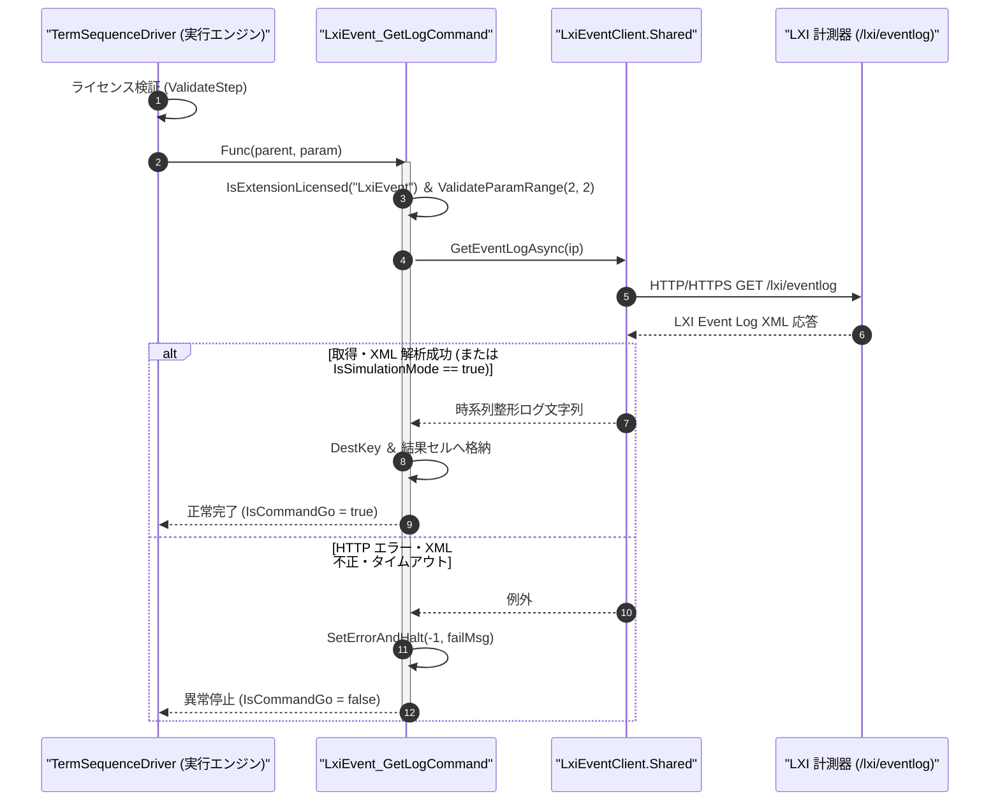

# コマンドリファレンス：LxiEvent_GetLog

👉 [← LxiEvent アドイン取扱説明書に戻る](./LxiEvent取扱説明書.Md)

## 概要

**LxiEvent_GetLog** は、LXI Event Logs Extended Function 対応計測器（または `TermEmulator` 仮想ノード）の HTTP / HTTPS エンドポイント（`http(s)://<IP>/lxi/eventlog`）から LXI Event Log（XML）を取得し、時系列テキストへ展開して変数および結果セルへ出力するログ収集コマンドです。

---

## 💡 書式・パラメータ仕様

### コマンド構文

```csv
,SEQUENCE, [ステップキー], LxiEvent_GetLog, "[IP]", "[DestKey]"
```

### パラメータ（引数）一覧

| 引数位置 | 引数名 | 必須/任意 | 説明・制約 |
| :--- | :--- | :---: | :--- |
| 第 1 引数 | `IP` | 必須 | Event Log を取得する LXI 計測器の IPv4 / IPv6 アドレスまたはホスト名（ポート指定可、例: `"192.168.0.10"` または `"127.0.0.1:8080"`）。 |
| 第 2 引数 | `DestKey` | 必須 | 時系列展開されたイベントログ文字列を格納する `PARAM` 変数キー名。 |

---

## 🔄 特殊置換規約・分岐規約の適用

* **動的置換（`$`）**: 全引数で `$PARAMキー$` による動的置換に対応します。
* **ジャンプ先指定（`#`）**: 非適用。
* **共通コマンド指定（`@`）**: 非適用。
* **エイリアス（別名）**: `Analysis_LxiEvent_GetLog`, `Sqn_LxiEvent_GetLog`

---

## 💡 動作例（正しい構文での記述例）

### スクリプト記述例

※COMMAND ブロック配下の子要素行（PARAM, SEQUENCE）は必ず行頭カンマから開始し、スペースインデントや行末コメント（`;`）は記述しないでください。

```csv
COMMAND, "SAMPLE_LXIEVENT_GETLOG", "LOG_TEXT"
,PARAM, "LOG_TEXT", Work, "取得イベントログ", ""
; 192.168.0.10 の LXI Event Log (XML) を取得・時系列展開
,SEQUENCE, 010, LxiEvent_GetLog, "192.168.0.10", "LOG_TEXT"
,SEQUENCE, 020, Exit, "$LOG_TEXT$", 0
```

### 実行時の挙動・変数変化

* **実行前の状態**: `"LOG_TEXT"` が空文字の状態。
* **実行後の状態**: `http(s)://192.168.0.10/lxi/eventlog` から XML を取得し、`System.Xml.Linq.XDocument` で各 `<EventLogEntry>` の時刻・EventID・送信元を時系列整形した文字列が `"LOG_TEXT"` および結果セルへ格納されます。

---

## 🔄 動作フロー（シーケンス図）



---

## 🚫 エラーハンドリング・安全設計（仕様制限）

1. **ライセンス・引数検証**: `LxiEvent` 未認証時は `-100`、引数不足・超過（`ValidateParamRange(2, 2)` 違反）時は停止します。
2. **HTTPS / 自己署名証明書対応**: `TermAnalysis.Lxi.Core` の `LxiSecurityHelper` ポリシーに従い、HTTPS 対応機の信頼済みサムプリント検証を適用します。

---

## 🧪 ユニットテスト仕様

本コマンドクラス（`LxiEvent_GetLogCommand.cs`）に実装されている `RunUnitTest()` メソッドの検証仕様です。

### テスト実行前提条件

* **実行トリガー**: `RunUnitTest()` メソッドの呼び出し
* **有効化条件**: `ErrorLogger.MinimumLevel == LogLevel.Test` であること（それ以外は早期リターン）
* **検証結果出力**: `_log.LogTest` へ出力。`finally` で `IsSimulationMode` を復元。

### テストケース一覧

| No | テストカテゴリ | テスト条件（入力値） | 期待される結果（出力値） | 検証の目的 / 観点 |
| :---: | :--- | :--- | :--- | :--- |
| **1** | 正常系 | `IsSimulationMode = true` 下で `"192.168.0.10"`, `"LOG_TEXT"` を実行 | `!HasError`、`IsCommandGo == true`、`LOG_TEXT` に模擬イベントログエントリが格納される | Event Log XML 取得・展開の検証 |
| **2** | 異常系 | 引数 1 個のみ（`DestKey` 欠落）で実行 | `ValidateParamRange(2, 2)` 違反で `HasError == true` かつ `!IsCommandGo` となる | 引数不足拒否の検証 |