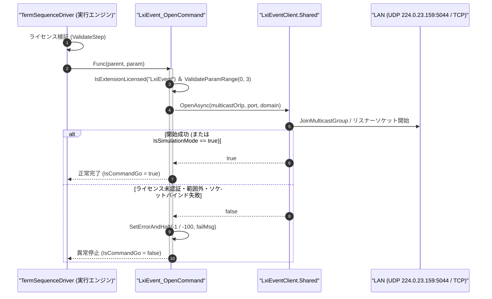

# コマンドリファレンス：LxiEvent_Open

👉 [← LxiEvent アドイン取扱説明書に戻る](./LxiEvent取扱説明書.Md)

## 概要

**LxiEvent_Open** は、LXI Event Messaging 規格に基づき、指定されたマルチキャストグループ（既定 `224.0.23.159`）または TCP ユニキャストポート・LXI ドメイン番号でイベント送受信リスナーを開始する通信制御系コマンドです。`LxiEventClient.Shared.OpenAsync()` を介して `UdpClient`（マルチキャストグループ参加）または `TcpClient` リスナーを初期化します。

---

## 💡 書式・パラメータ仕様

### コマンド構文

```csv
,SEQUENCE, [ステップキー], LxiEvent_Open, "[MulticastOrIp: 224.0.23.159]", "[Port: 5044]", "[Domain: 0]"
```

※ 引数を省略した場合は、プロパティ設定画面「LXI Event」タブの現在値が適用されます。

### パラメータ（引数）一覧

| 引数位置 | 引数名 | 必須/任意 | 説明・制約 |
| :--- | :--- | :---: | :--- |
| 第 1 引数 | `MulticastOrIp` | 任意 | マルチキャストアドレス（LXI 標準既定: `"224.0.23.159"`）または TCP ユニキャスト接続先 IP アドレス。 |
| 第 2 引数 | `Port` | 任意 | LXI Event 通信ポート番号（`1`〜`65535`、LXI 標準既定: `"5044"`）。 |
| 第 3 引数 | `Domain` | 任意 | LXI イベントドメイン番号（`0`〜`255`、既定: `"0"`）。同一 LAN 内で複数ラインのイベントを分離するために使用します。 |

---

## 🔄 特殊置換規約・分岐規約の適用

* **動的置換（`$`）**: 全引数で `$PARAMキー$` による動的置換に対応します。
* **ジャンプ先指定（`#`）**: 非適用。
* **共通コマンド指定（`@`）**: 非適用。
* **エイリアス（別名）**: `Analysis_LxiEvent_Open`, `Sqn_LxiEvent_Open`

---

## 💡 動作例（正しい構文での記述例）

### スクリプト記述例

※COMMAND ブロック配下の子要素行（PARAM, SEQUENCE）は必ず行頭カンマから開始し、スペースインデントや行末コメント（`;`）は記述しないでください。

```csv
COMMAND, "SAMPLE_LXIEVENT_OPEN", "EVT_INFO"
,PARAM, "EVT_INFO", Work, "受信イベント情報", ""
; 1. LXI 標準マルチキャスト・ドメイン 0 でイベントリスナー開始
,SEQUENCE, 010, LxiEvent_Open, "224.0.23.159", 5044, 0
; 2. LAN0 トリガイベントを送出
,SEQUENCE, 020, LxiEvent_Send, "LAN0"
; 3. 計測器からの完了イベント LAN1 を最大 5 秒待機
,SEQUENCE, 030, LxiEvent_Wait, "LAN1", 5000, "EVT_INFO"
,SEQUENCE, 040, LxiEvent_Close
,SEQUENCE, 050, Exit, "$EVT_INFO$", 0
```

### 実行時の挙動・変数変化

* **実行前の状態**: イベントリスナーが未起動の状態。
* **実行後の状態**: `LxiEventClient.Shared` がマルチキャストグループ `224.0.23.159:5044`（Domain `0`）へ参加し、バックグラウンド受信キューで LXI イベントパケットの監視を開始します。

---

## 🔄 動作フロー（シーケンス図）



---

## 🚫 エラーハンドリング・安全設計（仕様制限）

1. **ライセンス検証および引数範囲ガード**: `LxiEvent` 未認証時は `-100`、引数 4 個以上は `ValidateParamRange(0, 3)` 違反、ドメイン番号が `0`〜`255` 範囲外の場合は `SetErrorAndHalt(-1, failMsg)` で停止します。
2. **ReuseAddress によるポート共有**: 同一 PC 上で `TermEmulator` や他プロセスとマルチキャスト受信を併用できるよう `SocketOptionName.ReuseAddress` を有効化してバインドします。

---

## 🧪 ユニットテスト仕様

本コマンドクラス（`LxiEvent_OpenCommand.cs`）に実装されている `RunUnitTest()` メソッドの検証仕様です。

### テスト実行前提条件

* **実行トリガー**: `RunUnitTest()` メソッドの呼び出し
* **有効化条件**: `ErrorLogger.MinimumLevel == LogLevel.Test` であること（それ以外は早期リターン）
* **検証結果出力**: `_log.LogTest` へ出力。`finally` で `LxiEventClient.Shared.IsSimulationMode` を復元。

### テストケース一覧

| No | テストカテゴリ | テスト条件（入力値） | 期待される結果（出力値） | 検証の目的 / 観点 |
| :---: | :--- | :--- | :--- | :--- |
| **1** | 正常系 | `IsSimulationMode = true` 下で `"224.0.23.159"`, `"5044"`, `"0"` を指定 | `!HasError`、`IsCommandGo == true`、`Domain == 0`、`Port == 5044` となる | マルチキャストリスナー開始の検証 |
| **2** | 異常系 | ドメイン番号 `"300"`（範囲外）または余剰引数 4 個を指定 | `HasError == true` かつ `!IsCommandGo` となる | ドメイン範囲外・引数超過の拒否検証 |