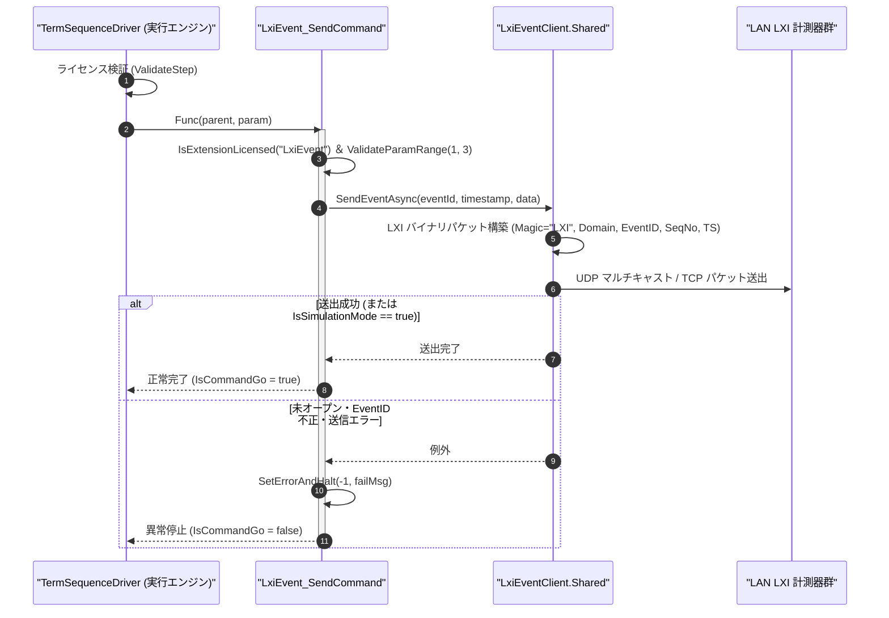

# コマンドリファレンス：LxiEvent_Send

👉 [← LxiEvent アドイン取扱説明書に戻る](./LxiEvent取扱説明書.Md)

## 概要

**LxiEvent_Send** は、LXI Event Messaging 規格のバイナリパケット（マジック `"LXI"` 3B ＋ Domain 1B ＋ EventID 16B ＋ SequenceNumber 4B ＋ TimestampSeconds 4B ＋ TimestampNanoseconds 4B ＋ Flags ＋ 任意データ）を構築し、LAN 上の計測器群へ一斉送出するイベント送信コマンドです。`LxiEventClient.Shared.SendEventAsync()` を実行します。

---

## 💡 書式・パラメータ仕様

### コマンド構文

```csv
,SEQUENCE, [ステップキー], LxiEvent_Send, "[EventID]", "[Timestamp(任意)]", "[Data(任意)]"
```

※ `Timestamp` を省略または `"0"` / `"NOW"` とした場合は即時発火イベントとして送出されます。`LxiSync_CalcFutureTime` で算出した未来タイムスタンプを渡すことで時刻指定一斉トリガが可能です。

### パラメータ（引数）一覧

| 引数位置 | 引数名 | 必須/任意 | 説明・制約 |
| :--- | :--- | :---: | :--- |
| 第 1 引数 | `EventID` | 必須 | 送出する LXI イベント識別子（最大 16 バイト ASCII。例: `"LAN0"`〜`"LAN7"`、`"TRIG_START"`）。 |
| 第 2 引数 | `Timestamp` | 任意 | 発火予定タイムスタンプ（`"<Seconds>.<Nanoseconds>"` 形式、例: `"1735689600.500000000"`）。省略時は即時発火（`0.0`）。 |
| 第 3 引数 | `Data` | 任意 | イベントパケットのデータフィールドへ添付する任意文字列または HEX データ。省略時はデータ部なし。 |

---

## 🔄 特殊置換規約・分岐規約の適用

* **動的置換（`$`）**: 全引数で `$PARAMキー$` による動的置換に対応します（例: `$FUTURE_TS$`）。
* **ジャンプ先指定（`#`）**: 非適用。
* **共通コマンド指定（`@`）**: 非適用。
* **エイリアス（別名）**: `Analysis_LxiEvent_Send`, `Sqn_LxiEvent_Send`

---

## 💡 動作例（正しい構文での記述例）

### スクリプト記述例

※COMMAND ブロック配下の子要素行（PARAM, SEQUENCE）は必ず行頭カンマから開始し、スペースインデントや行末コメント（`;`）は記述しないでください。

```csv
COMMAND, "SAMPLE_LXIEVENT_SEND", "RES"
,PARAM, "FUTURE_TS", Work, "未来タイムスタンプ", "1735689600.500000000"
,PARAM, "RES", Work, "結果", "OK"
,SEQUENCE, 010, LxiEvent_Open, "224.0.23.159", 5044, 0
; 指定未来時刻で LAN0 イベントを一斉送出
,SEQUENCE, 020, LxiEvent_Send, "LAN0", "$FUTURE_TS$", "CH1_START"
,SEQUENCE, 030, LxiEvent_Close
,SEQUENCE, 040, Exit, "$RES$", 0
```

### 実行時の挙動・変数変化

* **実行前の状態**: イベントリスナーが開始され、送信先ドメインが設定されている状態。
* **実行後の状態**: シーケンス番号が自動インクリメントされた LXI Event パケットが LAN へ送出され、送出完了後に次ステップへ進みます。

---

## 🔄 動作フロー（シーケンス図）



---

## 🚫 エラーハンドリング・安全設計（仕様制限）

1. **EventID 制約チェック**: `EventID` が空文字または 16 バイト超過（非 ASCII 含む）の場合は `SetErrorAndHalt(-1, failMsg)` で停止します。
2. **タイムスタンプ形式検証**: 第 2 引数指定時は `"<uint32>.<uint32>"` 形式（ナノ秒 `0`〜`999999999`）を厳密検証し、不正書式を拒否します。

---

## 🧪 ユニットテスト仕様

本コマンドクラス（`LxiEvent_SendCommand.cs`）に実装されている `RunUnitTest()` メソッドの検証仕様です。

### テスト実行前提条件

* **実行トリガー**: `RunUnitTest()` メソッドの呼び出し
* **有効化条件**: `ErrorLogger.MinimumLevel == LogLevel.Test` であること（それ以外は早期リターン）
* **検証結果出力**: `_log.LogTest` へ出力。`finally` で `IsSimulationMode` を復元。

### テストケース一覧

| No | テストカテゴリ | テスト条件（入力値） | 期待される結果（出力値） | 検証の目的 / 観点 |
| :---: | :--- | :--- | :--- | :--- |
| **1** | 正常系 | `IsSimulationMode = true` 下で `"LAN0"`, `"1735689600.500000000"`, `"TEST"` を送出 | `!HasError`、`IsCommandGo == true`、構築パケット先頭が `"LXI"` かつ `EventID == "LAN0"` | パケット構築・送出の検証 |
| **2** | 異常系 | 17 文字以上の `EventID`（`"12345678901234567"`）を指定 | `HasError == true` かつ `!IsCommandGo` となる | EventID 16 バイト上限超過の拒否検証 |