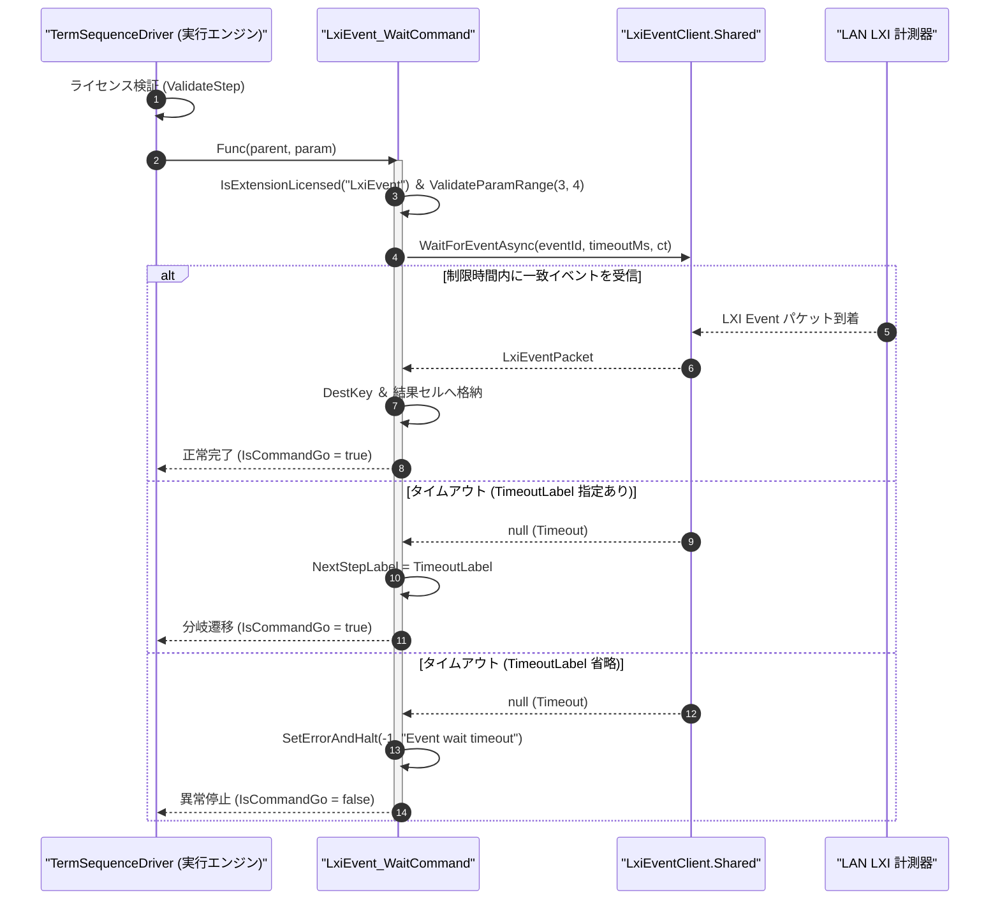

# コマンドリファレンス：LxiEvent_Wait

👉 [← LxiEvent アドイン取扱説明書に戻る](./LxiEvent取扱説明書.Md)

## 概要

**LxiEvent_Wait** は、LXI 計測器から送出される指定 `EventID`（`LAN0`〜`LAN7` やカスタムイベント）の到着をタイムアウト付きで非同期待機し、受信したイベントのタイムスタンプ・送信元 IP・ペイロードを変数へ格納する同期制御コマンドです。タイムアウト時の任意ラベル分岐（`#ラベル#`）に対応します。

---

## 💡 書式・パラメータ仕様

### コマンド構文

```csv
,SEQUENCE, [ステップキー], LxiEvent_Wait, "[EventID]", "[TimeoutMs]", "[DestKey]", "[TimeoutLabel(任意)]"
```

※ `TimeoutLabel`（例: `"#EVT_TIMEOUT#"`）を指定した場合、タイムアウト時はエラー停止せず指定ラベルへ分岐します。省略時はタイムアウトエラーとして停止します。

### パラメータ（引数）一覧

| 引数位置 | 引数名 | 必須/任意 | 説明・制約 |
| :--- | :--- | :---: | :--- |
| 第 1 引数 | `EventID` | 必須 | 待機対象の LXI イベント識別子（例: `"LAN1"`, `"MEAS_DONE"`）。`"*"` 指定時はドメイン内の任意イベントを受信します。 |
| 第 2 引数 | `TimeoutMs` | 必須 | イベント到着の最大待機時間［ミリ秒］（`100`〜`600000`）。 |
| 第 3 引数 | `DestKey` | 必須 | 受信イベント情報（`"<EventID>,<SourceIP>,<Seconds>.<Nanoseconds>,<Data>"` 形式）を格納する `PARAM` 変数キー名。 |
| 第 4 引数 | `TimeoutLabel` | 任意 | タイムアウト発生時のジャンプ先ラベル（`#LABEL#` 形式）。省略時はエラー停止します。 |

---

## 🔄 特殊置換規約・分岐規約の適用

* **動的置換（`$`）**: 第 1〜第 3 引数で `$PARAMキー$` による動的置換に対応します。
* **ジャンプ先指定（`#`）**: 第 4 引数 `TimeoutLabel` に `#ラベル名#` を指定することで、タイムアウト時の分岐制御が可能です。
* **共通コマンド指定（`@`）**: 非適用。
* **エイリアス（別名）**: `Analysis_LxiEvent_Wait`, `Sqn_LxiEvent_Wait`

---

## 💡 動作例（正しい構文での記述例）

### スクリプト記述例

※COMMAND ブロック配下の子要素行（PARAM, SEQUENCE）は必ず行頭カンマから開始し、スペースインデントや行末コメント（`;`）は記述しないでください。

```csv
COMMAND, "SAMPLE_LXIEVENT_WAIT", "EVT_DATA"
,PARAM, "EVT_DATA", Work, "受信イベント", ""
,SEQUENCE, 010, LxiEvent_Open, "224.0.23.159", 5044, 0
,SEQUENCE, 020, LxiEvent_Send, "LAN0"
; LAN1 完了イベントを最大 10 秒待機（未到着時は #EVT_TIMEOUT# へ分岐）
,SEQUENCE, 030, LxiEvent_Wait, "LAN1", 10000, "EVT_DATA", "#EVT_TIMEOUT#"
,SEQUENCE, 040, LxiEvent_Close
,SEQUENCE, 050, Exit, "$EVT_DATA$", 0
,SEQUENCE, #EVT_TIMEOUT#, LxiEvent_Close
,SEQUENCE, 070, Exit, "TIMEOUT", -1
```

### 実行時の挙動・変数変化

* **実行前の状態**: イベントリスナーが稼働し、`"EVT_DATA"` が空文字の状態。
* **実行後の状態**: 対象 `EventID` を受信すると `"LAN1,192.168.0.10,1735689600.123456789,OK"` のような構造化文字列が `"EVT_DATA"` および結果セルへ格納されます。タイムアウトかつ `TimeoutLabel` 指定時は指定ラベルへジャンプします。

---

## 🔄 動作フロー（シーケンス図）



---

## 🚫 エラーハンドリング・安全設計（仕様制限）

1. **ライセンス・引数検証**: `LxiEvent` 未認証時は `-100`、引数不足・超過（`ValidateParamRange(3, 4)` 違反）時は停止します。
2. **キャンセル・タイムアウト保護**: ユーザー中断（`CancellationToken`）および `TimeoutMs` 超過時に確実に待機を解除し、デッドロックを防止します。

---

## 🧪 ユニットテスト仕様

本コマンドクラス（`LxiEvent_WaitCommand.cs`）に実装されている `RunUnitTest()` メソッドの検証仕様です。

### テスト実行前提条件

* **実行トリガー**: `RunUnitTest()` メソッドの呼び出し
* **有効化条件**: `ErrorLogger.MinimumLevel == LogLevel.Test` であること（それ以外は早期リターン）
* **検証結果出力**: `_log.LogTest` へ出力。`finally` で `IsSimulationMode` を復元。

### テストケース一覧

| No | テストカテゴリ | テスト条件（入力値） | 期待される結果（出力値） | 検証の目的 / 観点 |
| :---: | :--- | :--- | :--- | :--- |
| **1** | 正常系 | `IsSimulationMode = true`（模擬イベント `LAN1` 投入済み）で `"LAN1"`, `"3000"`, `"EVT_DATA"` を実行 | `!HasError`、`IsCommandGo == true`、`EVT_DATA` に `"LAN1"` を含む文字列が格納される | イベント待機受信・変数格納の検証 |
| **2** | 異常系 | 引数 2 個のみ（必須 `DestKey` 欠落）で実行 | `ValidateParamRange(3, 4)` 違反で `HasError == true` かつ `!IsCommandGo` となる | 必須引数欠落の拒否検証 |