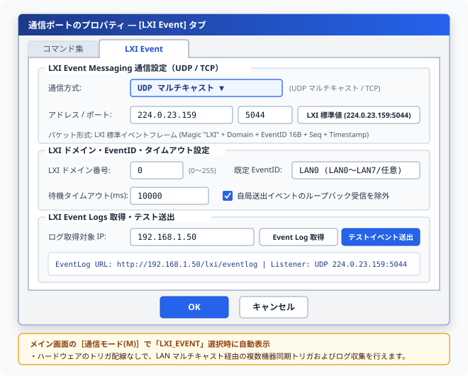
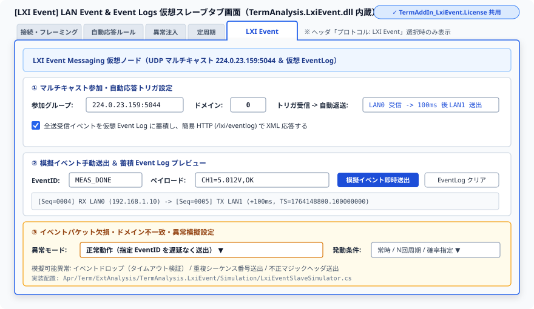

# LxiEvent（LXI Event Messaging & Event Logs）アドイン取扱説明書

👉 [← TermAddIn_LxiEvent 製品トップに戻る](../README.md)  
👉 [← プロパティ設定画面取扱説明書（共通）](../プロパティ設定画面取扱説明書.Md) ／ [← TermEmulator 操作説明書（共通）](https://github.com/Monaca-App/TermEmulator/blob/main/Manual/TermEmulator操作説明書.Md) ／ [← マクロスクリプト取扱説明書（共通）](../マクロスクリプト取扱説明書.Md)

---

本書は、**TermAddIn_LxiEvent**（`TermAnalysis.LxiEvent.dll`：LXI Event Messaging & Event Logs 拡張エクステンション）の **取扱説明書 兼 機能解説書** です。ハードウェアのトリガ配線なしで、LAN（UDP マルチキャスト `224.0.23.159:5044` / TCP）上のイベント同期トリガ送受信と LXI Event Logs 取得を自動化します。LXI Event の仕組み解説、プロパティ設定画面の **「LXI Event」タブ**、**TermEmulator の `[LXI Event]` 仮想ノードタブ**、および全 5 コマンドのリファレンスを 1 冊にまとめています。

* **必須拡張ライセンス**: **`TermAddIn_LxiEvent.License`** （組み込み先: `TermAnalysis.LxiEvent.dll`、`TermEmulator` と相互共用）


### 関連する公式規格・仕様書（外部リンク）
* [IVI Foundation 公式仕様ポータル（計測器制御・LXI 連携関連規格）](https://www.ivifoundation.org/specifications/default.aspx) — 計測器制御プロトコル仕様を参照できます（本アドインは LXI Consortium 策定の *LXI Event Messaging Extended Function*［マルチキャスト `224.0.23.159:5044`・ドメイン・EventID・タイムスタンプ］および *LXI Event Logs Extended Function*［`/lxi/eventlog` XML］に準拠）。
---

## 目次

- [1. 機能概要と基礎知識（はじめての方へ）](#1-機能概要と基礎知識はじめての方へ)
- [2. プロパティ設定画面：「LXI Event」タブの詳細](#2-プロパティ設定画面lxi-eventタブの詳細)
- [3. TermEmulator 仮想スレーブ設定：「[LXI Event]」タブの詳細](#3-termemulator-仮想スレーブ設定lxi-eventタブの詳細)
- [4. マクロコマンド一覧（全 5 コマンド）](#4-マクロコマンド一覧全-5-コマンド)

---

## 1. 機能概要と基礎知識（はじめての方へ）

### 対応する機能の概要
**LxiEvent（LXI Event Messaging & Event Logs）** アドインは、LXI 拡張規格の **Event Messaging** および **Event Logs** に対応し、LAN ケーブル経由で複数台の計測器へ一斉トリガイベント（`LAN0`〜`LAN7` やカスタムイベント）を送出・非同期受信待機（タイムアウト分岐対応）し、さらに計測器内蔵のイベント履歴（XML）を収集・時系列展開するイベント連携機能です。

### 機能の実現方法
* **LXI 標準イベントパケットの Pure C# 構築・解析**: `UdpClient`（標準マルチキャスト `224.0.23.159:5044`、`ReuseAddress` 対応）および `TcpClient` を用い、LXI 規格のバイナリパケット（マジック `"LXI"`・Domain・EventID・SequenceNumber・Timestamp・データ部）を直接送受信します。
* **タイムアウト分岐付き非同期待機 ＆ HTTP/HTTPS ログ取得**: `LxiEvent_Wait` で特定イベント到着を待機（未到着時は `#ラベル#` へ分岐可能）し、`LxiEvent_GetLog` で `http(s)://<IP>/lxi/eventlog` の XML を自動パースして Excel へ出力します。
* **仮想イベントノード模擬**: `TermEmulator` の `[LXI Event]` タブでマルチキャストイベント送受信および仮想 `/lxi/eventlog` 応答を模擬でき、実機なしで同期シーケンスを検証できます。

### このアドインを選択することの利点
* **トリガ用同軸ケーブル（BNC）の配線コスト・手間を削減**: 複数台の計測器に個別のトリガ配線を引き回す必要がなく、既存の LAN ケーブル 1 本で一斉開始・完了通知を実現できます。
* **ポーリング監視の無駄を省きタクトタイム短縮**: 「終わったか？」を何度も問い合わせる代わりに、計測器からの完了イベント到着で即座に次工程へ進めるため、検査時間を短縮できます。
* **トラブル時の原因切り分けが容易**: `LxiEvent_GetLog` で全計測器のイベント履歴を時系列で回収でき、「どの機器のトリガが抜けたか」を客観的に追跡できます。

### どんな場面で役立つのか（具体例）
* **一斉スタート**: パソコンから「`LAN0`（スタートの合図）」を 1 回送るだけで、同じ LAN に繋がっている電源・DMM・オシロスコープが同時に動き出します。
* **完了待ちの自動化**: 計測器が測定を終えた瞬間に「`LAN1`（完了の合図）」を自動発信し、パソコン側が `LxiEvent_Wait` でそれを受け取って次の工程へ進みます。
* **イベント履歴の調査**: `LxiEvent_GetLog` で計測器内部に残っている「いつ何の合図が起きたか」のログを取り出し、トラブル解析に使えます。

### 設定の妥当性を判断するためのチェックポイント
| 確認項目 | 項目の意味 | 設定値の目安・確認方法 |
| :--- | :--- | :--- |
| **通信方式（UDP マルチキャスト / TCP）** | 全機器へ一斉に放送するか、1 台だけへ送るか | 複数台へ同時に合図を送る LXI 標準の使い方は **`UDP マルチキャスト`**（既定）です。 |
| **マルチキャストアドレス / ポート** | イベント配信用のマルチキャストアドレスとポート番号 | LXI 規格で **`224.0.23.159` / ポート `5044`** と決まっています。特別な理由がない限り **既定値のまま変更しません**。 |
| **LXI ドメイン番号（`0`〜`255`）** | 隣の検査ラインと合図が混ざらないようにする「グループ番号」 | 1 つのラインだけなら既定の **`0`** で問題ありません。同じ LAN 内に 2 つ以上の検査ラインがあるときは、ラインごとに番号を分けます（例: ライン A は `0`、ライン B は `1`）。 |
| **待機タイムアウト** | 計測器からの合図を待ち続ける最大時間 | 既定の **`10000` ms（10 秒）** を目安に、1 回の測定にかかる時間より少し長めに設定します。 |

### 通信の仕組み解説（LXI Event パケット構造と代表的なトラブル事例・対処法）
LXI Event Messaging では、以下の固定バイナリ形式のパケットがマルチキャスト（`224.0.23.159:5044`）で同じドメイン内の全計測器へ一斉配信されます。

```text
["LXI" 3B] + [Domain 1B (0〜255)] + [EventID 16B ("LAN0"〜"LAN7"等)] + [SeqNo 4B] + [Timestamp 8B] + [任意Data]
```

* **事例①：`LxiEvent_Send` を送っても計測器が反応しない** ➔ 計測器側で「トリガソース ＝ LAN Event（例: `LAN0`）」が有効化されていない、または PC と計測器の **Domain 番号** が食い違っているケースがほとんどです。
* **事例②：ルータ越しの計測器へイベントが届かない** ➔ UDP マルチキャストは原則同じ LAN（同一サブネット）内のみに届きます。ルータ越しに送りたい場合は TCP ユニキャスト方式を使用してください。
* **事例③：`LxiEvent_Wait` が毎回タイムアウトする** ➔ 計測器が発信している `EventID` の大文字・小文字や名称（例: `LAN1` vs `MEAS_DONE`）を `LxiEvent_GetLog` で確認すると原因をすぐ特定できます。

---

## 2. プロパティ設定画面：「LXI Event」タブの詳細



メイン画面で **`LXI_EVENT`** モードを選択しているときに表示され、`LxiEvent_Open` 等のイベント通信条件を設定します。

| 項目名 | 設定値・範囲（既定値） | 詳しい意味と設定のポイント |
| :--- | :--- | :--- |
| **`通信方式`** | `UDP マルチキャスト`（既定） / `TCP ユニキャスト` | LXI 標準のマルチキャストイベント配信、または特定 IP 向け TCP イベント送受信を選択します。 |
| **`マルチキャストアドレス / ポート`** | `224.0.23.159` / `5044`（LXI 標準既定値） | LXI Event Messaging の標準マルチキャストグループおよびポート番号です。 |
| **`LXI ドメイン番号`** | `0`〜`255`（既定 `0`） | 同一 LAN 内で複数ラインのイベントを分離するためのドメイン番号を指定します。 |
| **`待機タイムアウト`** | ミリ秒（既定 `10000` ms） | `LxiEvent_Wait` でイベント到着を待機する既定タイムアウト時間です。 |

---

## 3. TermEmulator 仮想スレーブ設定：`[LXI Event]` タブの詳細



* **主な用途**: LXI Event Messaging 対応計測器のイベント送受信・イベントログ蓄積の仮想模擬。
* **模擬機能**:
  * UDP サーバーチャネルへマルチキャストグループ参加（`224.0.23.159:5044`）機能を備え、LXI 標準パケット（マジック `"LXI"`・Domain・EventID `LAN0`〜`LAN7`・SequenceNumber・Timestamp）の受信監視・模擬イベント自動送出を再現。
  * 受信・送出したイベント履歴を仮想 Event Log として蓄積し、簡易 HTTP `/lxi/eventlog` エンドポイント経由で `LxiEvent_GetLog` からの XML 取得テストを完結可能。

---

## 4. マクロコマンド一覧（全 5 コマンド）

| コマンド名 | 構文概要 | 主な役割・用途 |
| :--- | :--- | :--- |
| **[LxiEvent_Open](./LxiEvent_Open.Md)** | `,SEQUENCE, [ステップ], LxiEvent_Open, "[MulticastOrIp(任意)]", [Port(任意: 5044)], [Domain(任意: 0)]` | 指定ドメイン・マルチキャスト／TCP ポートでイベントリスナーを開始 |
| **[LxiEvent_Close](./LxiEvent_Close.Md)** | `,SEQUENCE, [ステップ], LxiEvent_Close` | イベントリスナーを停止し、マルチキャストグループから離脱 |
| **[LxiEvent_Send](./LxiEvent_Send.Md)** | `,SEQUENCE, [ステップ], LxiEvent_Send, "[EventID]", "[Timestamp(任意)]", "[Data(任意)]"` | 指定 `EventID`（`LAN0`〜`LAN7` やカスタム名）、即時／未来タイムスタンプ、任意データを送出 |
| **[LxiEvent_Wait](./LxiEvent_Wait.Md)** | `,SEQUENCE, [ステップ], LxiEvent_Wait, "[EventID]", [TimeoutMs], "[DestKey]", "[TimeoutLabel(任意)]"` | 指定 `EventID` の受信をタイムアウト付きで非同期待機し、受信時刻・送信元 IP・ペイロードを変数へ格納 |
| **[LxiEvent_GetLog](./LxiEvent_GetLog.Md)** | `,SEQUENCE, [ステップ], LxiEvent_GetLog, "[IP]", "[DestKey]"` | 指定 IP の LXI 計測器から LXI Event Log（XML）を取得し、時系列展開して出力 |
